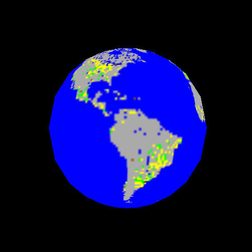
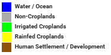

# G.R.E.E.N
Global Resources of Economic and Ecological Nature

# Sobre

G.R.E.E.N é um visualizador terrestre que mostra área de cultivo no mundo todo.
Ele faz isso através da projeção de diversos mapas de regiões de diferentes formas de cultivo, como culturas de sequeiro e cultura de irrigadas 

## Módulos e pacotes utilizados:
- GLFW
- PyOpenGL
- ctypes
- NumPy
- math

## Como usar:
Cada ponto colorido sobreposto no planeta corresponde a um tipo diferente de cultura de plantio, por exemplo, áreas verdes são áreas de cultura de irrigadas, ou seja, o plantio é feito através da irrigação artificial. Abaixo está a legenda:

Para movimentar o globo basta usar:
- → para movimentar a leste
- ← para movimentar para oeste
- ↑ para movimentar para o norte
- ↓ para movimentar para sul
- \+ para ampliar o globo
- \- para diminuir o globo

